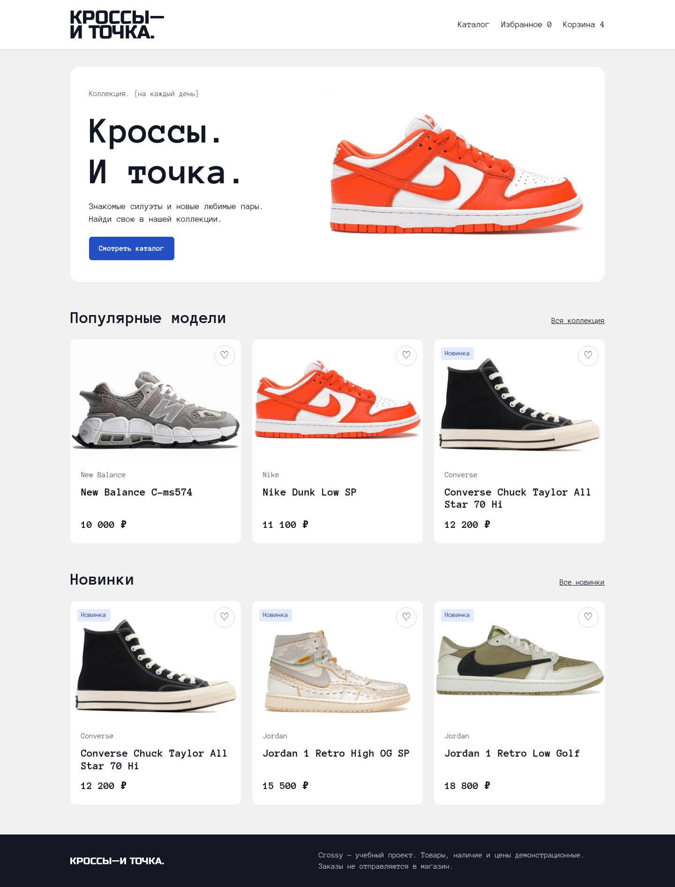
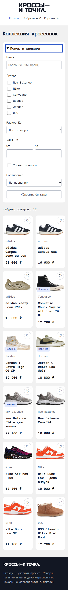

# Crossy — Кроссы и точка

Учебный адаптивный магазин кроссовок для портфолио frontend-разработчика. Сохранены логотип, Anonymous Pro, светло-серый фон и белые карточки исходного проекта. В каталоге 12 демонстрационных товаров. Реальных продаж нет.

## Возможности

- Главная с популярными моделями и новинками.
- Каталог: поиск по названию и бренду, несколько брендов, размер EU, цена от/до, новинки и три варианта сортировки. Фильтры работают вместе.
- Параметры URL восстанавливают поиск при открытии ссылки, перезагрузке и переходах назад/вперёд.
- Единая страница `product.html?id=2`, переключение общего вида и увеличенного фрагмента, выбор размера, доступные уведомления.
- Избранное с сохранением, повторным удалением и общими счётчиками.
- Корзина: отдельные позиции для размеров, объединение повторных добавлений, количество, удаление и итог.
- Демонстрационный заказ: ошибки возле полей, фокус на первом некорректном поле, адрес только при доставке, итоговая сводка.
- Мобильные фильтры раскрываются через нативный `details`. Модальных окон нет; ловушка фокуса не требуется. Навигация доступна без раскрывающегося меню.
- Видимый фокус, семантическая разметка, клавиатура, `aria-pressed`, `role=status`, reduced motion, локальные WebP с lazy loading.

## Стек и запуск

HTML5, SCSS, JavaScript ES Modules, Vite, Vitest. Без фреймворков, сервера приложения и оплаты. Нужен Node.js 20.19+ или 22.12+.

```bash
npm ci
npm run dev
npm test
npm run build
npm run preview
```

`dev` запускает локальную разработку, `build` создаёт `dist`, `preview` позволяет проверить результат сборки.

Результаты выполненных проверок: [CHECKS.md](CHECKS.md).

## Структура

```text
index.html, catalog.html, product.html, favorites.html, cart.html
src/
  data/products.json      # единственный источник товаров
  logic/filters.js        # чистая фильтрация, сортировка, URL
  logic/cart.js           # чистые операции с корзиной и расчёт
  logic/storage.js        # адаптер localStorage с резервом в памяти
  logic/store.js          # состояние и подписки на изменения
  logic/checkout.js       # проверка полей без DOM
  components/ui.js        # карточки, цена, уведомления, пустые состояния
  components/checkout.js  # форма и сводка заказа
  pages/                  # код каждой страницы
  styles/main.scss        # общий адаптивный интерфейс
  main.js                 # общая шапка, подвал, счётчики и запуск страниц
public/images/            # локальные изображения
public/fonts/             # локальный Anonymous Pro
tests/logic.test.js        # тесты ключевых правил
deploy/                   # Nginx и обновление сайта
pages/page1..3.html        # переходы со старых адресов
```

## Как устроены фильтры и данные

`filterProducts` сначала отбирает товары по всем условиям, потом сортирует новый массив. Исходный JSON не изменяется. Поиск приводит текст к нижнему регистру, обрезает и объединяет пробелы. Выбранные бренды объединяются условием «или», разные типы фильтров — условием «и».

Параметры: `q`, повторяющийся `brand`, `size`, `min`, `max`, `new=1`, `sort=name|price-asc|price-desc`. Например: `catalog.html?brand=Nike&size=40&sort=price-asc`. Обновление запроса задержано на 180 мс, чтобы не перерисовывать карточки при каждом быстром нажатии. `popstate` восстанавливает форму при навигации по истории. Если цена «от» больше «до», результатов нет.

Товар содержит `id`, `name`, `brand`, `category`, `price`, `images`, `sizes`, `description`, `isNew`. Новую модель можно добавить в JSON без создания новой HTML-страницы. Пути изображений задаются относительно корня публикации. Vite настроен с `base: './'`, поэтому сборка подходит и для подкаталога.

## Корзина и хранение

В `crossy.cart.v1` хранятся только `{ productId, size, quantity }`. Ключ позиции — сочетание товара и размера. В `crossy.favorites.v1` — уникальные идентификаторы. Цены, названия и фото всегда берутся из JSON. `store` меняет данные, сохраняет их и уведомляет интерфейс через подписки. Чистые функции корзины не знают о DOM и localStorage, поэтому их удобно тестировать.

Повреждённый JSON, неизвестные товары, отсутствующие размеры, дробные и отрицательные количества отбрасываются. Недоступное хранилище или ошибка записи включают резерв в памяти: сайт работает до перезагрузки. Изменения в других вкладках обрабатываются через событие `storage`. Данные относятся к браузеру и адресу сайта; между устройствами не синхронизируются.

## Ограничения заказа

Имя, телефон, email и адрес используются только для проверки текущей формы. Они не записываются в localStorage, не отправляются по сети и не попадают в сводку. После успешного оформления форма уничтожается, корзина очищается, показываются товары и сообщение: «Демонстрационный заказ оформлен. Данные не отправлялись в магазин». Перезагрузка не сохраняет сводку. Серверной проверки, оплаты, доставки и реального наличия нет.

## Скриншоты интерфейса

### Главная



### Каталог на телефоне



## Публикация на статическом хостинге

1. Выполнить `npm ci`, `npm test`, `npm run build`.
2. Загрузить **содержимое** `dist` в корневую директорию сайта. Не загружать `node_modules`, исходники и контакты.
3. Настроить выдачу `index.html` и обычных HTML-файлов; SPA fallback не нужен.
4. Проверить `catalog.html`, `product.html?id=2`, изображения и перезагрузку прямой ссылки.
